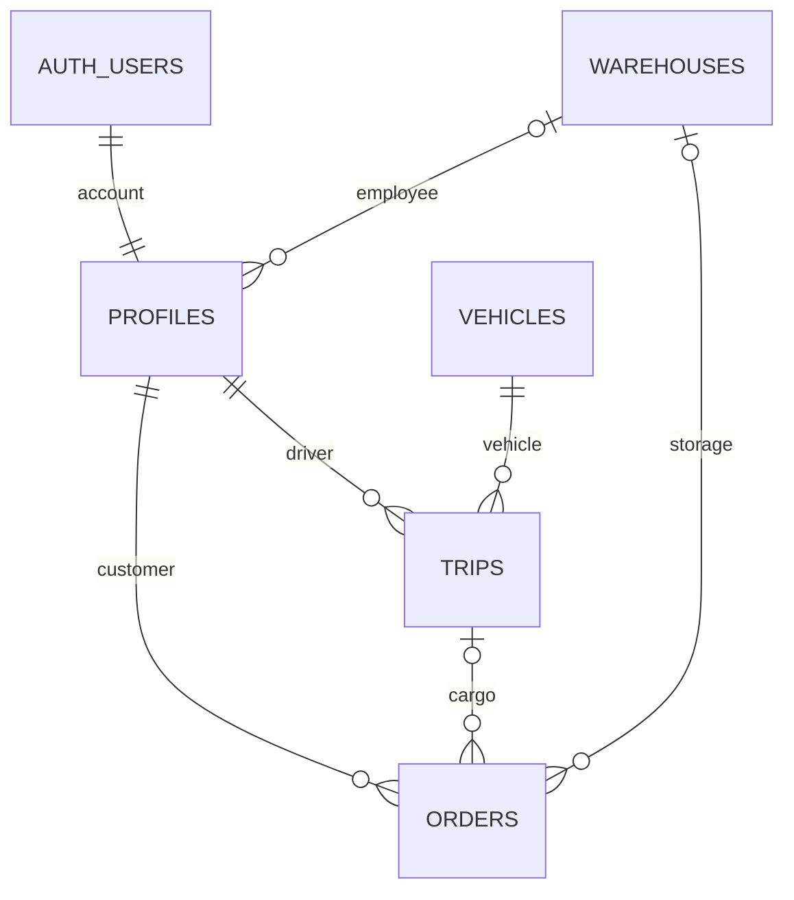

# Вектор — веб-приложение логистической компании

Адаптивный сайт с общей базой **PostgreSQL в Supabase**. Docker, VPS и отдельный Node.js-сервер приложения не нужны. GitHub хранит исходники, GitHub Pages размещает интерфейс, Supabase обеспечивает PostgreSQL, авторизацию и API. Node.js нужен только для сборки и тестов; на компьютерах сотрудников ничего устанавливать не требуется.

## Что реализовано

- Регистрация с подтверждением почты; новый аккаунт ожидает одобрения администратора.
- Вход по паролю через Supabase Auth. Пароли не сохраняются в таблицах приложения.
- Заказы, рейсы, автомобили, склады, профили пользователей и история действий в PostgreSQL.
- Кабинет заказчика — только свои заявки; кабинет водителя — только назначенные рейсы и грузы.
- Офис — обработка заявок, формирование рейсов, выбор водителя и склада.
- Склад — приёмка и подготовка грузов только своего склада.
- Директор — просмотр и аналитика; администратор — все разделы и настройка прав.
- Проверка вместимости, отдельной машины, направления, готовности склада, занятости водителя и машины.
- Расчёт цены выполняется в базе, цена и владелец из браузера не принимаются на доверии.
- GitHub Actions запускает SQL-тесты, собирает сайт и публикует его на GitHub Pages.

## Быстрый запуск по ссылке

### 1. Создайте проект Supabase

Создайте проект на https://supabase.com/dashboard. Это управляемый PostgreSQL, а не замена PostgreSQL другой базой. В Supabase SQL Editor выполните **`sql/001_schema.sql` целиком один раз** в новом проекте. Скрипт транзакционный. Не запускайте его поверх чужой схемы и не изменяйте уже применённую миграцию — дальнейшие изменения должны быть отдельными SQL-миграциями.

Схема `vektor` остаётся приватной. **Не добавляйте её в список Exposed schemas.** В Data API остаётся стандартная схема `public`: из неё вызываются только пять строго ограниченных функций `vektor_*`.

В настройках Authentication оставьте подтверждение email включённым, задайте минимальную длину пароля 12 символов. Для реальных пользователей настройте почтовую отправку и лимиты Auth в своём проекте. Пароль базы и секретный ключ в код не вставлять.

### 2. Загрузите этот проект в GitHub

Загрузите **содержимое папки проекта в корень репозитория**, включая `.github/workflows/pages.yml`, `package.json`, `package-lock.json`, `src/`, `sql/`, `scripts/` и `tests/`.

Если используете Git из терминала:

```sh
git init -b main
git add .
git commit -m "Add Vektor PostgreSQL web application"
git remote add origin https://github.com/YOUR_ACCOUNT/YOUR_REPOSITORY.git
git push -u origin main
```

Это команды для вашего репозитория; удалённый репозиторий автоматически не создаётся. Для существующего репозитория согласуйте структуру и ветку вместо повторного `git init`.

### 3. Добавьте две публичные переменные

GitHub → Settings → Secrets and variables → Actions → **Variables**:

| Имя | Значение |
|---|---|
| `SUPABASE_URL` | URL проекта вида `https://project-ref.supabase.co` |
| `SUPABASE_PUBLISHABLE_KEY` | Публичный ключ вида `sb_publishable_…` из настроек проекта Supabase |

Этот ключ предназначен для браузера. **Не используйте `service_role`, `sb_secret_…` или пароль PostgreSQL.** Сборка принимает только новый publishable-ключ.

### 4. Включите GitHub Pages

GitHub → Settings → Pages → Build and deployment → Source: **GitHub Actions**.

В Actions запустите workflow `Test and deploy web application`, либо отправьте коммит в `main`. После успешного Deploy адрес появится в окружении `github-pages`. Для репозитория сайта обычно используется адрес вида `https://ACCOUNT.github.io/REPOSITORY/`. Все ресурсы сайта используют относительные пути и работают в подпапке репозитория.

Если выбранный тариф или политика GitHub не разрешают Pages для вашего репозитория, можно разместить готовую папку `dist` на другом статическом HTTPS-хостинге. База и авторизация от этого не меняются.

### 5. Настройте ссылки подтверждения почты

В Supabase Authentication → URL Configuration установите Site URL равным точному адресу сайта, включая подпапку репозитория и завершающий `/`. Добавьте этот же адрес в Redirect URLs. Для локальной разработки отдельно добавьте `http://localhost:5173/`.

### 6. Создайте первого администратора

1. Откройте сайт, зарегистрируйте свой аккаунт и подтвердите email.
2. Откройте `sql/002_first_admin.sql`, замените `REPLACE_WITH_YOUR_CONFIRMED_EMAIL` на свою подтверждённую почту.
3. Выполните скрипт через Supabase SQL Editor. Он откажется работать, если администратор уже существует.
4. На сайте нажмите «Проверить доступ» или войдите заново.

Администратора нельзя получить через форму регистрации или подменой полей браузера.

### 7. Подготовьте работу компании

В кабинете администратора создайте склады и автомобили. Сотрудники и заказчики регистрируются самостоятельно. В «Пользователи» администратор одобряет аккаунты, назначает роли, доступные разделы и склад сотрудника.

Обычный сценарий: заказчик создаёт заявку → офис принимает её → создаёт рейс → назначает заявку на рейс и при необходимости склад → склад принимает и готовит груз → офис отправляет рейс → назначенный водитель подтверждает доставку. Последняя доставка завершает рейс и освобождает водителя и машину.

## Локальная разработка без Docker

Нужны Node.js 22+ и npm. Из корня проекта:

```sh
npm ci
cp .env.example .env
# Укажите URL и публичный ключ вашего Supabase в .env
npm test
npm run build
npm run dev
```

Откройте `http://localhost:5173/`. Скрипт `dev` — обычная раздача статических файлов для разработки, не сервер бизнес-логики. Он не соединяется с PostgreSQL и не получает пароль базы. Без настроенных переменных сборка показывает честный экран подключения, без вымышленных данных.

## Как защищён доступ

- Таблицы находятся в приватной схеме `vektor`. Прямых прав на таблицы у `anon` и `authenticated` нет.
- RLS включён на всех таблицах; без политик действует запрет по умолчанию. Клиент получает данные только через разрешённые RPC-функции.
- Функции `SECURITY DEFINER` используют пустой `search_path`, полностью квалифицированные имена и проверяют `auth.uid()`, статус аккаунта, роль, раздел и принадлежность записи.
- `anon` не имеет права выполнять функции приложения. Неодобренному аккаунту доступен только собственный профиль и его статус.
- Клиент передаёт данные операций, а не SQL. Функций для выполнения произвольного SQL нет.
- Обновление прав вступает в силу при следующем запросе, даже если JWT пользователя ещё действителен. Открытый интерфейс обновляется раз в минуту; уже показанные данные невозможно отозвать из памяти браузера.
- Все изменения записи и событие аудита выполняются в одной транзакции. На старте изменения сериализуются advisory-lock: это предотвращает гонки назначения грузов, но при высокой нагрузке блокировку нужно сделать более узкой.
- Водителю и складу не возвращается стоимость заказов. Заказчик не получает чужие заявки, списки пользователей и внутренние рейсы.
- Сессией управляет Supabase Auth; SDK хранит токен сессии в браузере. **Сами заказы и аккаунты не хранятся в localStorage**.

## Структура базы

| Таблица | Назначение |
|---|---|
| `auth.users` | Учётные записи и аутентификация, управляются Supabase Auth |
| `vektor.profiles` | Имя, роль, запрошенная роль, статус одобрения, разделы доступа, склад |
| `vektor.orders` | Владелец заказа, груз, адреса, даты, цена, статус, рейс, склад |
| `vektor.trips` | Направление, водитель, автомобиль и состояние рейса |
| `vektor.vehicles` | Машины, номера, грузоподъёмность и объём |
| `vektor.warehouses` | Склады и адреса |
| `vektor.routes` | Демонстрационный справочник межгородских расстояний |
| `vektor.events` | История изменений с автором и временем |



## Проверки и ограничения текущей версии

`npm test` выполняет схему и SQL-функции на PGlite — PostgreSQL-движке в WASM. Тесты проверяют регистрацию, запрет самоназначения администратора, права SQL-ролей, чужие данные, расчёт цены, вместимость, складской процесс, доставку и немедленное применение новых прав. Это не имитация SQL-запросов. Supabase Auth/API и настоящее развёртывание отдельно нужно проверить после подключения вашего проекта; тестовая схема `auth` в PGlite заменяет только окружение авторизации.

Текущие границы:

- Тарифы и расстояния демонстрационные. Дорожный маршрут, геокодирование и GPS ещё не подключены.
- У одной заявки один рейс и один склад. Многоэтапные перевозки через несколько рейсов и складов требуют следующей миграции и отдельного интерфейса.
- Один водитель и автомобиль — один незавершённый рейс. Планирование нескольких будущих рейсов по временным окнам пока не реализовано.
- Отображаются последние 500 заявок/рейсов/профилей; аналитика по этим заявкам. Для больших объёмов нужна пагинация и серверные агрегаты.
- Нет оплаты, вложений, восстановления пароля через интерфейс, отмены заказов и автоматической маршрутизации. Нельзя считать эту версию полностью готовой промышленной системой.
- Тесты не заменяют нагрузочную проверку или аудит развёртывания. Резервное копирование, размещение и параметры Auth выбираются в вашем проекте Supabase.

## Справочная документация

- https://supabase.com/docs/guides/database/functions
- https://supabase.com/docs/guides/database/postgres/row-level-security
- https://supabase.com/docs/guides/getting-started/api-keys
- https://supabase.com/docs/reference/javascript/auth-signup

Никаких Docker-файлов, публичных паролей, секретных ключей и платных подключений в проекте нет. Для запуска нужен ваш проект Supabase и ваш репозиторий GitHub.
